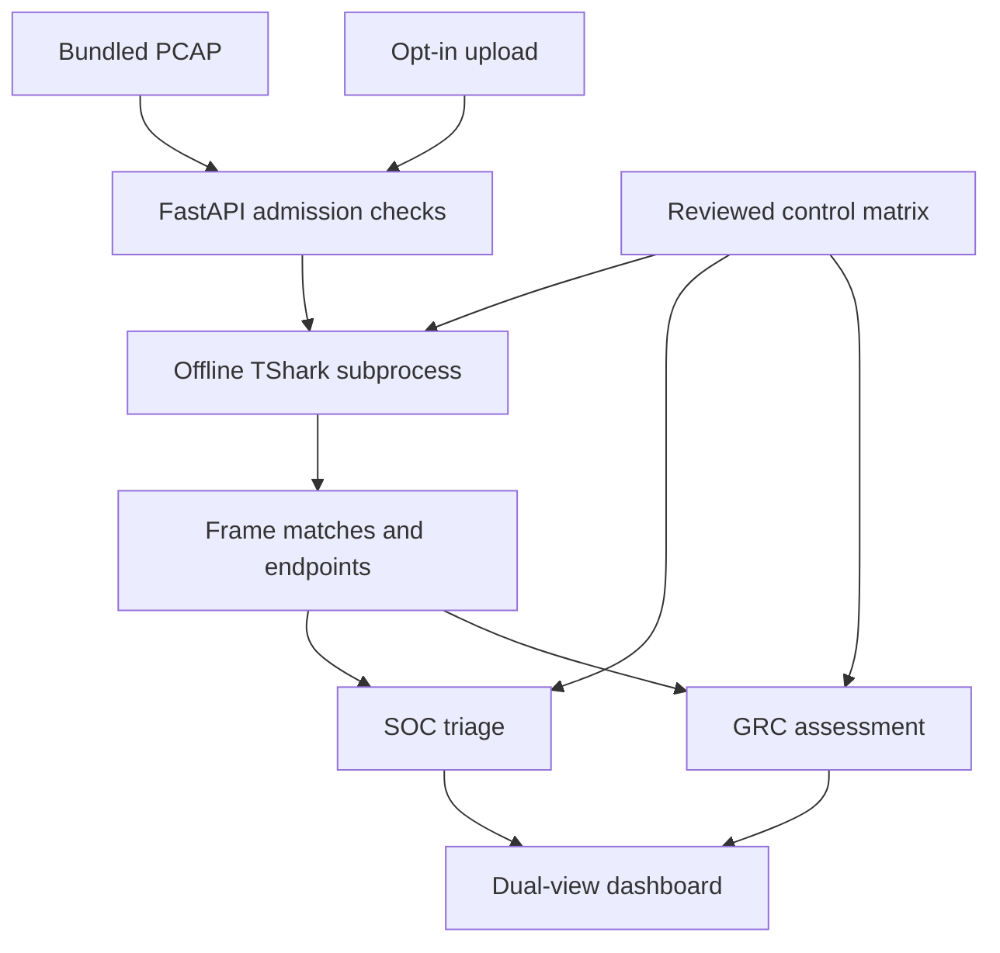

# SentinelGRC

Investigate an offline packet capture in a SOC workbench, then switch to the GRC view to see the same evidence mapped to ISO/IEC 27001:2022 Annex A controls. Each finding includes an ATT&CK technique, up to ten sample frames, a containment checklist, host-local firewall proposals and an executive brief.

## Open the project in Visual Studio Code

Open **SentinelGRC.code-workspace** in VS Code. For an immediate offline walkthrough, open `app/static/index.html` in a browser. Choose **Change capture**, select a scenario and switch between **SOC & network** and **GRC & audit**. The offline view labels its evidence **Fixture replay**.

### Run the full service with Docker

With Docker Engine and Compose available, run this in the project terminal:

```sh
docker compose up --build
```

Open [the workbench](http://127.0.0.1:8000/). The container includes TShark and serves the app and its local assets. Stop the service with `docker compose down`.

### Run directly on macOS or Linux

Use Python 3.11 or later. Install Wireshark/TShark for live packet inspection. The app checks PATH and the standard macOS Wireshark application directory. The included fixtures remain available when TShark is absent.

```sh
python3 -m venv .venv
source .venv/bin/activate
python -m pip install -r requirements-dev.txt
ENABLE_UPLOADS=1 RULES_FILE=.sentinel-rules.json CAPTURE_LIBRARY_DIR=.sentinel-captures python -m uvicorn app.main:app --host 127.0.0.1 --port 8000
```

In VS Code, **Terminal → Run Task → Start SentinelGRC** starts the same server. With the Microsoft Python debugger extension installed, select the project interpreter and press **F5** to debug. The **Test SentinelGRC** task runs the test suite. The default server binds to loopback.

With TShark installed, open **Capture library → Custom capture** and choose or drop a PCAP or PCAPNG. Analysis starts automatically and opens the workbench.

Successful local uploads appear under **Saved captures**. Open one to analyse it against the current rules. The Workbench lists every rule applied to the displayed result, including rules with zero matches. Uploaded files are kept in the local `.sentinel-captures` folder when the library is enabled.

The capture overview lists the protocol mix, busiest IP endpoints, and packet evidence for activity worth reviewing. It highlights configured rule matches and patterns such as TCP port probing, repeated resets, DNS name errors, and plaintext HTTP. Suggestions link to existing findings or offer a capture-specific filter to draft a rule. These observations describe traffic seen in the file and require analyst review.

Open **Detection rules** to add, edit, or delete rules on the local Python server. Rules use TShark display filters against IPv4 traffic. Changes are saved in `.sentinel-rules.json` and apply to the next analysis, including bundled captures. The catalogue can hold up to 12 rules. The bundled sample captures remain available after their original rules are deleted.

## Sample scenarios

| Capture | Evidence | Expected rule match | Baseline → elevated risk |
| --- | --- | --- | --- |
| Ransomware C2 | 12 repeated HTTP requests matching a legacy client and path signature | NET-SOC-101 · T1071.001 | 8 → 25 |
| SQL injection indicators | 3 HTTP requests containing an inert SQL keyword marker | NET-SOC-102 · T1190 | 8 → 25 |
| SSH connection burst | 8 distinct connection attempts to one SSH service within 60 seconds | NET-SOC-103 · T1110 hypothesis | 4.8 → 15 |

Each capture also contains four ordinary HTTP requests. The generator uses documentation IP addresses and an invalid example hostname. The SQL marker is inert. Confirm suspected beaconing with endpoint evidence, possible data access with application logs, and suspected guessing with authentication logs. Encrypted application content, IPv6, and traffic outside the three filters are outside this detector's coverage.

## Architecture



- `app/data/control_matrix.json` defines signatures, ATT&CK tags, response steps, control mappings and scoring inputs.
- `app/services/pcap_parser.py` runs fixed display filters and extracts numeric frame and IPv4 metadata. The SSH rule groups distinct source ports by source and destination in a rolling 60-second window.
- `app/services/grc_engine.py` computes inherent risk as likelihood × impact, a baseline scenario score of 40% of inherent risk, and an elevated score of inherent risk × rule penalty capped at 25.
- `app/services/soc_triage.py` produces deterministic briefs or local model drafts. Scores and control states always come from the rules.
- `app/static/` contains the responsive dashboard and its local assets. The frontend inserts returned evidence as text. The SVG trace plots actual lengths for up to ten displayed matching frames.

The model's PASS and FAIL labels apply to a single rule and capture. An auditor needs more evidence to determine control effectiveness. A matching frame opens a privacy review. The organisation assesses whether a personal data breach occurred, the risk to people and when it became aware. Record those decisions. [ICO breach guidance](https://ico.org.uk/for-organisations/report-a-breach/personal-data-breach/personal-data-breaches-a-guide/)

## Runtime settings

| Variable | Default | Purpose |
| --- | --- | --- |
| `PORT` | `8000` | Container listening port, configurable by the host |
| `ENABLE_UPLOADS` | `0` | Set to `1` to accept custom captures when TShark is present |
| `RULES_FILE` | unset | Set a writable local JSON path to enable rule editing on loopback with TShark installed |
| `CAPTURE_LIBRARY_DIR` | unset | Set a writable local folder to retain uploads and reopen them on the loopback server |
| `ENABLE_OLLAMA` | `0` | Set to `1` to request local model briefs |
| `REQUIRE_TSHARK` | `1` in Docker | Fail readiness and sample analysis if the required binary is missing |
| `GITHUB_REPOSITORY` | unset | Optional `owner/repository` metadata returned by `GET /api/v1/config` |

To inspect an authorised capture using Docker, run `ENABLE_UPLOADS=1 docker compose up --build` and select **Capture library → Custom capture**. Docker uses temporary upload storage. Uploads are capped at 50 MiB and 10,000 frames. Each dissection has CPU, output and wall-clock limits. Linux also caps parser address space. A single worker admits two jobs concurrently and 30 job starts per minute.

The portfolio deployment runs the bundled scenarios with uploads disabled. The app has no user accounts. For a hosted service handling private captures, put it behind your identity-aware proxy and configure ingress body, timeout and rate limits. Terminate HTTPS at the hosting edge. Keep the container and its OS packages patched. The image runs as a non-root user and omits the live capture helper. Compose drops all capabilities and uses a read-only root filesystem.

For local Ollama, install the `llama3.1:8b` model, run Ollama on loopback and start the native Python service with `ENABLE_OLLAMA=1`. The client connects to `127.0.0.1:11434` in the server's own network namespace. Only curated rule metadata and aggregate counts enter the prompt. Missing models, timeouts and malformed model output fall back to labelled rule-based briefs.

## Publish to GitHub

The local project is prepared for Git. In VS Code, open **Source Control → Publish Branch**, choose your GitHub account, repository name and visibility. For an existing **empty** remote repository, run the following in the project terminal after replacing the example URL:

```sh
git remote add origin https://github.com/YOUR-ACCOUNT/YOUR-REPOSITORY.git
git push -u origin main
```

If you opened a downloaded source ZIP, initialise its extracted directory first with `git init -b main`, `git add .`, and `git commit -m "Add SentinelGRC workbench"`. For an existing repository with history, bring the source into a feature branch of its clone and submit a pull request. The project's ignore rules exclude virtual environments, credentials and custom captures.

## Host on Render

1. Push the project to GitHub with `render.yaml` and `Dockerfile` at the repository root.
2. In Render, choose **New → Blueprint** and connect that repository. The blueprint selects a Docker web service and the `/healthz` readiness path.
3. Review the proposed service name, plan and any costs, then apply the blueprint. Optionally set `GITHUB_REPOSITORY` to your repository name.
4. Visit the assigned HTTPS URL. Run each sample and check that the analysis engine reads **TShark**.

The Docker service can also run on another container host that provides a writable temporary directory. A static-only host serves fixture replay. [Render Docker deployment](https://render.com/docs/docker)

## Verification and screenshots

```sh
python -m unittest discover -v
python -m scripts.generate_samples
git diff --exit-code -- sample_pcaps app/static/demo-data.js
```

The tests cover matches and clean outcomes, SHA-checked fixture replay, SSH windowing, direction-aware firewall drafts, scoring, model fallback, upload validation and cleanup, security headers and admission controls. Two integration tests require TShark and run in the Docker test stage.

GitHub Actions builds the test and production images, verifies TShark results against the fixtures, exercises the SOC and GRC views, tests capture upload and rule navigation, and checks the mobile layout. Start the Docker service with `ENABLE_UPLOADS=1 docker compose up --build` before running the browser check locally.

```sh
python -m pip install playwright==1.65.2
python -m playwright install chromium
python -m scripts.browser_check
```

The script writes `soc.png` and `grc.png` under `docs/screenshots/`. GitHub Actions saves them in the **sentinelgrc-screenshots** artifact. The OpenAPI schema is available at `/openapi.json`.
